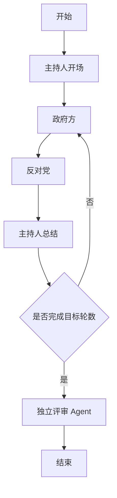
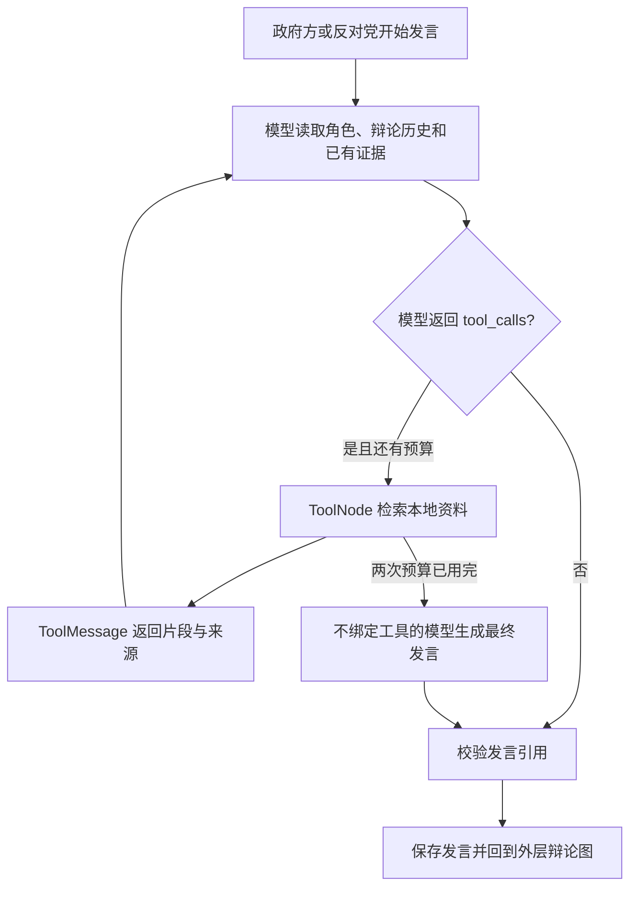

# 多智能体议会辩论 · Parliament Sim v2

基于 **LangChain + LangGraph + DeepSeek** 的中文命令行项目。输入议题后，主持人、政府方、反对党和独立评审通过共享上下文完成一场辩论。适合学习状态图和面试演示。

外层是固定轮次辩论，开启 `--rag` 后，政府方和反对党在各自发言子图内自主决定检索本地资料。四个角色共用 DeepSeek 模型；文档向量保存在独立 Redis 索引。保留第一版无检索模式，不做联网搜索、网页、人工介入或断点恢复。

## 安装与第一版兼容模式

建议 Python 3.12，在本仓库创建独立环境：

```bash
python3 -m venv .venv
source .venv/bin/activatettt
pip install -r requirements.txt
# 完全复现验证环境时，改用 pip install -r requirements-lock.txt
```

先运行无需密钥、无需网络的离线示例：

```bash
python main.py --topic "是否应该实行四天工作制" --rounds 3 --mock-llm
```

离线内容是固定测试数据，不代表模型能力或真实评分。可阅读 [离线完整记录](docs/offline-example/transcript.md)。

真实运行：

```bash
cp .env.example .env
# 在 .env 中填写 DEEPSEEK_API_KEY；不要提交密钥
python main.py --topic "是否应该实行四天工作制" --rounds 3
```

默认模型 `deepseek-chat`，可用 `DEEPSEEK_MODEL` 覆盖。只加载本仓库 `.env`，已有环境变量优先，不自动读取其他项目的密钥。所有角色共用模型配置；请求超时 60 秒，SDK 对可重试请求错误最多重试一次。

| 参数 | 默认值 | 含义 |
|---|---|---|
| `--topic` | 是否应该实行四天工作制 | 非空议题 |
| `--rounds` | 3 | 1–5 轮；双方各发言一次算一轮 |
| `--output` | results | 结果根目录，每次创建独立子目录 |
| `--mock-llm` | 关闭 | 固定离线示例 |

默认三轮：主持人开场 1 次、双方发言 6 次、主持总结 3 次、评审 1 次，共 11 次模型调用。格式修正或网络重试可能增加调用次数。

## 架构与职责



- **LangChain**：`ChatPromptTemplate → ChatDeepSeek → StrOutputParser` 生成普通发言；评审使用 `PydanticOutputParser` 校验结构化结果。使用拆分包 `langchain-core` 和 `langchain-deepseek`，无需安装顶层 `langchain` 包。
- **LangGraph**：`StateGraph` 管理节点、共享状态、追加 reducer 和条件边。每个节点只返回增量，避免历史重复。
- **上下文**：保存完整的角色、轮次和发言。政府方第二轮开始能看到上一轮反对意见；反对党能看到当轮政府发言。评审能看到整个过程。
- **主持与路由**：主持内容由模型生成，是否结束由轮数规则决定。无需模型输出路由指令，流程可控且便于测试。
- **实时显示**：节点开始时显示生成状态；每个节点完成后立即打印全文和保存，不是逐 token 输出。

主要代码：`workflow.py`（状态图）、`state.py`（共享状态）、`simulation/`（角色和提示词）、`evaluation/evaluator.py`（评审）、`storage.py`（记录保存）、`main.py`（命令行）。详细数据流见 [架构说明](docs/ARCHITECTURE.md)。

## 模型评审

独立评审读取完整辩论，分别对双方的逻辑清晰度、回应质量、可行性和说服力打 0–10 分。每项提供理由及角色/轮次引用，并给出双方优缺点、胜方和总结。

胜方由模型整体判断，可以平局，不计算总分、不用关键词规则决定胜负。Python 仅校验数据结构、范围和引用是否存在；校验失败时传回原记录、错误输出与错误原因，最多修正一次。若仍失败，保留辩论并标记失败，不回退到规则评分。

引用校验不等于论证真实性核验。无检索模式没有外部证据；RAG 模式会将检索片段传给评审。两种模式的模型评分都属于模拟判断，不能作为客观事实标签；同一输入也可能得到不同结果。

## 输出与错误处理

每次运行生成 `results/<UTC时间_UUID>/`：

- `result.json`：议题、轮数、已完成轮数、角色记录、结构化评审、模型配置、运行状态、耗时及错误。
- `transcript.md`：完整中文记录、评分、理由和引用，便于阅读。

每个节点完成后更新文件，每个文件使用临时文件替换，减少写入中断造成损坏的风险。文件是审阅记录，不支持恢复执行。退出码 0 表示成功，1 表示运行或保存失败，2 表示命令行参数错误。

| 情况 | 处理 |
|---|---|
| 缺少密钥 | 提示配置 `DEEPSEEK_API_KEY`；离线模式不需要密钥 |
| 认证失败或余额不足 | 检查密钥及账户额度，已有记录保留 |
| 超时或网络错误 | SDK 按配置重试，最终失败返回非零退出码 |
| 评审 JSON/引用无效 | 请求一次修正，仍失败则评审为空并保存错误 |
| Ctrl+C | 保存已完成节点，当前未完成发言不进入记录 |
| 无写入权限 | 显示保存失败，选择有写权限的 `--output` 路径 |

`.env` 和运行结果默认忽略；导出配置中不保存密钥。

## 测试与面试演示

```bash
python -m pytest -q
```

测试使用假模型，不访问网络，覆盖 1/3/5 轮路由、完整上下文、会话隔离、引用校验、评审修正、超时、逐节点持久化和命令行输入。

面试可按此顺序展示：输入议题 → 观察角色交替和回应 → 查看评审理由对应的轮次 → 展示 JSON → 对照状态图说明节点、边与 reducer。重点说明共享状态如何避免丢失上下文，以及为什么把评审判断交给模型、把流程终止和格式检查交给代码。

第二版的 RAG 与工具调用使用方法如下；网页和人工介入仍不在本版范围内。


## 第二版：准备本地知识库

技术栈：`langchain-redis` + Redis Search、DashScope `text-embedding-v3`、DeepSeek 原生工具调用。文档保存在本地，文档片段会发送到嵌入 API，检索结果会发送到 DeepSeek。不是完全离线推理。

在项目 `.env` 配置：

```dotenv
DEEPSEEK_API_KEY=你的密钥
DASHSCOPE_API_KEY=你的密钥
DEEPSEEK_MODEL=deepseek-chat
REDIS_URL=redis://127.0.0.1:6379/0
```

当前机器已有 Redis 容器，重启可用 `podman start langchain-redis`。其他机器需要支持 Search 的 Redis；例如：

```bash
podman run -d --name parliament-redis -p 127.0.0.1:6379:6379 \
  -v parliament-redis-data:/data docker.io/library/redis:8.4 redis-server --appendonly yes
```

下载、入库和检索是独立命令，辩论不会自动下载或入库：

```bash
python -m knowledge.download
python -m knowledge.ingest --input data/documents
python -m knowledge.search --query "四天工作制的实施困难"
python main.py --rag --topic "是否应该实行四天工作制" --rounds 3
```

下载脚本只处理 [来源清单](knowledge/sources.json) 中的 2023 英国试点报告和 2024 跟踪报告，在本地保存下载时间与 SHA-256。报告涉及相关试点群体，不是所有行业的代表性样本，也不构成完整的正反方证据库。英文原文保留，支持中文查询和发言。原始文件在 `data/` 中忽略，不提交报告全文。

也可将自己的 PDF 或 Markdown 放入资料目录；同目录 `sources.json` 可补充文件名、标题、发布机构、日期和 URL。PDF 必须有文本层，扫描件需自行 OCR。

- 默认切块为 1,000 字符、重叠 150 字符，不跨 PDF 页；Markdown 按标题分段。
- PDF 引用使用从 1 开始的**物理页码**，不保证等于报告印刷页码。
- 片段 ID 由文件、内容与切分配置确定；重复导入跳过，更新文件写入成功后再删除该文件旧片段。
- Redis 索引为 `parliament_sim_v2`，文档键前缀为 `parliament_sim_v2:doc`，配置与清单也在该项目命名空间内，不操作其他学习项目索引。
- 模型、实际向量维度或切分配置变化会拒绝混用。需要重建时显式执行 `python -m knowledge.ingest --input data/documents --rebuild`，仅清理本项目索引及文档键。删除本地文件不会自动删除库内旧资料，要移除这些资料可用所需目录显式重建。

## 第二版：自主工具调用



模型通过 `bind_tools` 发出真实 `AIMessage.tool_calls`，不是程序发现关键词后自动检索。工具返回最多 3 个候选片段，模型负责判断相关性和研究局限。

每次发言最多处理 2 个工具调用；缓存命中也占调用预算，但不再请求检索。模型一次请求多项工具时顺序处理，超出预算的调用仍返回对应 `ToolMessage`，保证协议配对，然后用未绑定工具的模型结束发言。未知工具和无效参数也占预算。每次发言重新创建消息历史及缓存；本场已公开的证据可共享。

引用格式为 `[E:片段ID]`。代码验证该 ID 是否在本场实际检索结果中，不验证它是否充分支持论点。无效引用修正一次后仍错误，会保留原文并标注警告，不算有效引用。评审增加 `evidence_comment`，评价证据支持度、研究范围与过度推广。

JSON 新增 `evidence`、`tool_logs`、`warnings`，辩论发言新增 `evidence_ids` 和 `invalid_evidence_ids`。工具日志记录查询、来源 ID、状态、缓存命中与耗时，不记录内部推理链。Markdown 增加检索过程、引用资料和警告。工具完成时立即保存，即使最终发言生成失败，仍可回看检索轨迹。

RAG 启动时缺密钥、Redis 不可用、索引为空或配置不匹配会明确失败。运行中单次检索失败则向模型返回工具错误，允许在预算内重试或说明证据不足；失败不会假装检索成功。

## 第二版测试和代码讲解

无需任何服务的完整离线演示：

```bash
python main.py --rag --mock-llm
python -m pytest -q
```

离线 RAG 使用真实工具协议和子图，但模型与资料都是固定测试数据，明确标记为虚构。真实 Redis 集成测试用 UUID 隔离索引，测试后仅删除自身数据，不调用嵌入 API：

```bash
RUN_REDIS_TESTS=1 python -m pytest -q
```

阅读 [第二版代码与面试讲解](docs/V2_WALKTHROUGH.md) 和 [验证记录](docs/V2_VALIDATION.md)。原有 `python main.py --mock-llm` 及不带 `--rag` 的真实运行保持可用。
